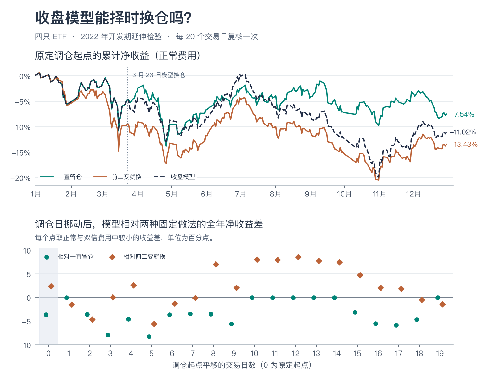

# 同一个收盘换留模型，走到 2022 年还能选对吗？

**这套模型能在部分行情中避开多余的换仓，但现有结果不足以用它替换现行策略。** 2017–2018 和 2020–2021 两段，原定调仓日程都能胜过两种固定做法。将同一模型从 2021 年底的实际模拟持仓接到 2022 年底，原定日程全年比留仓少赚 3.48 个百分点，最大回撤多 6.04 个百分点。把调仓起点逐日平移，2022 年有 7 个起点与一直留仓逐日相同，另 13 个收益更低。登记的通过条件为原定起点且至少 11/20 个起点同时胜过两种固定动作，两档费用下均需收益更高、回撤不加深。[事前协议](protocol.md) · [逐起点比较](comparison.json)

## 三段行情中的连续账户

每格为原定起点的**区间累计净收益 / 最大回撤**。早段在 2017 年初拟合换留模型，晚段在 2020 年初用同一方法重新拟合。2022 年直接沿用后一个模型的五项系数与阈值。每段内的账户从相同现金和份额出发，2022 年还接续原调仓日历。前两段各为两年，延伸段为一年。

| 期间 | 执行成本 | 收盘模型 | 一直留仓 | 前二与持仓不同时就换 |
| --- | --- | ---: | ---: | ---: |
| 2017–2018 | 正常 | +2.38% / 23.63% | −1.53% / 26.03% | −8.80% / 27.75% |
| 2017–2018 | 双倍 | +1.69% / 23.94% | −1.53% / 26.05% | −10.67% / 28.47% |
| 2020–2021 | 正常 | +38.14% / 14.99% | +8.47% / 15.22% | +30.56% / 14.99% |
| 2020–2021 | 双倍 | +37.77% / 15.03% | +8.46% / 15.20% | +28.67% / 15.03% |
| 2022 | 正常 | −11.02% / 20.42% | −7.54% / 14.38% | −13.43% / 20.99% |
| 2022 | 双倍 | −11.15% / 20.57% | −7.51% / 14.34% | −13.94% / 21.36% |

| 在两档成本下均取得更高收益、回撤不加深的起点 | 2017–2018 | 2020–2021 | 2022 |
| --- | ---: | ---: | ---: |
| 对一直留仓 | 2/20 | 1/20 | 0/20 |
| 对遇到不同前二就换 | 8/20 | 2/20 | 13/20 |
| 同时对两者 | 2/20 | 1/20 | 0/20 |



## 当时为什么换，为什么留

每 20 个交易日收盘，模型比较四只 ETF 中评分前二与实有持仓。两者不同，才估算换仓相对留仓的 20 日扣费净值差。输入是原始评分差、平滑评分差、相对不确定度差、市场仓位上限及预计权重变动量。估计为正，次日开盘按原总投入比例均分给评分前二；否则继续持有原份额。2020 年初冻结的换留系数由 702 个已经到期的交易日拟合，最后一个实际结果在 2019-12-30 揭晓。ETF 本身的基础评分仍按事前固定的程序每年更新。[冻结模型的训练截止日、样本数及文件摘要](audit.json) · [2022 年评分记录](official_forecast.json)

| 原定起点的收盘日 | 原持仓 → 评分前二 | 当天估算换仓多赚多少 | 当天决定 | 两本账户经过 20 日的实际差额 |
| --- | --- | ---: | --- | ---: |
| 2022-01-18 | 510500、510880 → 510050、510500 | −0.36 个百分点 | 留仓 | 换仓少 2.44 个百分点，留仓判断正确 |
| 2022-03-22 | 510500、510880 → 510050、510300 | +0.09 个百分点 | 换仓 | 换仓少 0.94 个百分点，留仓更好 |

只给截至上述各自收盘的行情和当天实际份额，分别重建自 2019 年起的 741、781 个交易日评分和平滑状态，两个决定及目标权重都与全年账本相同。预测净优势与全年回放最大相差 0.000022 个基点。

3 月 22 日，模型估计只多赚 8.78 个基点（100 基点为 1 个百分点）。当天市场仓位上限约 55.62%，这一输入给估值加了 56.53 基点，是最大的正向贡献。相对不确定度扣了 29.25 基点。3 月 23 日开盘成交，到 4 月 22 日开盘、新订单执行前，换仓账户为 164,473.09 元，同起点留仓账户为 166,100.64 元。这是原定日程当年唯一一次主动换仓。[两日收盘信息与五项贡献](decision_prefix.json) · [逐次两条路径](books.json)

## 把每个可换的收盘都复算一遍

正常费用下，从模型当天实际持有的账户复制出两份，一份在次日开盘换仓，一份保留全部份额；在第 21 个交易日开盘、下一张订单执行前结算。差额统一除以信号收盘的账户净值。同一次动作既可以在这个 20 日窗口失利，也可能改变更长时期的持仓。

| 已到期且可换的机会 | 可换次数 | 选换后换仓更好 | 选留后留仓更好 | 所有机会均摊，相对全留 / 全换 |
| --- | ---: | ---: | ---: | ---: |
| 2017–2018 | 393 | 95/200 | 96/193 | −8.06 / +2.83 基点 |
| 2020–2021 | 354 | 31/53 | 160/301 | +8.04 / −9.90 基点 |
| 2022 | 148 | 1/17 | 72/131 | −30.28 / +44.17 基点 |

2022 年选换的 17 次平均少赚 2.64 个百分点，其中 13 次集中在 3 至 5 月。选留的 131 次，留仓平均比换仓多 0.50 个百分点。各起点持有区间大量重叠，这些次数用于描述当时的选择，不能据此推断 17 次独立试验的成功率。年末 11 个可以换仓的收盘尚未到期，未用下一年行情补标签。前两段使用此前已经核对的跨年训练版本与连续账户归档。[配对计算与来源哈希](comparison.json)

## 时点、公司行为与复现边界

- 从 2019 年预热到 2021 年末，各费率、各起点分别对齐原账户。正常费用下，原定起点在 2021-12-31 持有 510500 共 10,400 份、510880 共 27,600 份，现金 16,889.44 元，总净值 182,150.24 元。三种做法自此共同起跑。只有第 9 个平移起点恰在当日复核，两种费用均判留仓，次年首日没有遗留买卖。2022 年最后一次收盘复核也没有待执行的换仓指令。[正式账本](books.json) · [独立复核](audit.json)
- 2022 年基础评分用 1,415 个训练日和 209 个校准日，训练与校准区间各剔除 21 个未到期标签，校准结果最晚到 2021-12-31。按 1 月 4 日、6 月 30 日和 8 月 29 日分别截断重训，所得排序与全年回放同日排序一致。沿用原研究的静态 ETF 关系先验，其历史发布时点未获逐条验证。所有研究价格和收益标签止于 2022-12-30。2022 已在项目的其他开发研究中使用，此处检验的是冻结换留模型跨年的表现。[数据范围与截断复核](official_forecast.json)
- 510500 在 2022-08-26 登记，按持有人总份额乘 1.14539 并向上取整，下一交易日计入新份额。公告口径下，上述留仓账户的 10,400 份变为 11,913 份，原数据快照和通用账本算为 11,912 份。两种口径分别重放全部 120 条路径，28 条年末净值有差，最大为 6.29 元；6 条路径的成交明细有差，全部收盘动作与年度通过起点一致。修正在本次实验中使用。[上交所披露的拆分公告](https://www.sse.com.cn/disclosure/fund/announcement/c/new/2022-08-23/510500_20220823_1_aMMa3ZNB.pdf) · [公告本地副本](510500_split_notice.pdf) · [逐账户影响](split_impact.json)
- 独立程序按两种折算口径各复建 120 本账。每种均核对 29,040 个账户交易日、927 笔成交、430 条现金及折算流水、1,452 个收盘判断。正常费用下的 221 个到期分支中有 21 个跨过拆分日。聚焦时点与可交易收益测试 8 项及 17 个子测试通过，研究线账本及时间线测试 27 项通过。基础评分、两套全量账本及独立审计各自在新位置重跑并通过逐字节比对。[独立程序](independent.py) · [核验明细](audit.json)

从 GitHub 下载本轮目录后，可直接查看两套逐日账本、三段对照与独立审计结果。以下命令只依赖 Python 标准库和本轮文件，可复算拆分对所有账户的影响并与归档逐字节比较。

```sh
study=artifacts/etf-close-carry-2022-20261127
out=$(mktemp -d)
python3 "$study/split_impact.py" --out "$out/split_impact.json"
cmp "$study/split_impact.json" "$out/split_impact.json"
```

完整重训与逐笔回放还需要本机的历史研究归档，包括此前的模型、历史账户、冻结评分代码，以及 `research_v1/artifacts/market-etf-verified-20261108` 行情快照。对应的路径与文件摘要见[评分来源](official_forecast.json)、[账本来源](books.json)及[独立审计](audit.json)。准备好这些输入后，从项目根目录运行下列命令，使用新的输出位置。评分和连续账本需要根目录虚拟环境中的 PyTorch，汇总和独立验算可使用研究线虚拟环境。正式账本已把报价文件摘要和拆分公告摘要写入来源字段。

```sh
study=artifacts/etf-close-carry-2022-20261127
out=$(mktemp -d)
.venv/bin/python "$study/forecast_2022.py" --out-dir "$out"
.venv/bin/python "$study/official_forecast.py" --official --out-dir "$out"
.venv/bin/python "$study/carry_books.py" --signals "$out/official_signals.npz" --out "$out/books.json"
.venv/bin/python "$study/carry_books.py" --snapshot-mode --signals "$out/signals.npz" --out "$out/snapshot_books.json"
research_v1/.venv/bin/python "$study/compare.py" --books "$out/books.json" --out "$out/comparison.json"
research_v1/.venv/bin/python "$study/independent.py" --out "$out/audit.json"
.venv/bin/python "$study/decision_prefix.py" --out "$out/decision_prefix.json"
research_v1/.venv/bin/python "$study/split_impact.py" --out "$out/split_impact.json"
python3 "$study/plot.py" --books "$out/books.json" --out "$out/paths.png"
```

独立审计与拆分差异脚本直接读取本实验目录的正式归档。对带文件路径的来源清单，新位置会改变清单中记录的路径；逐日份额、成交、判断和汇总数值可直接比较。
